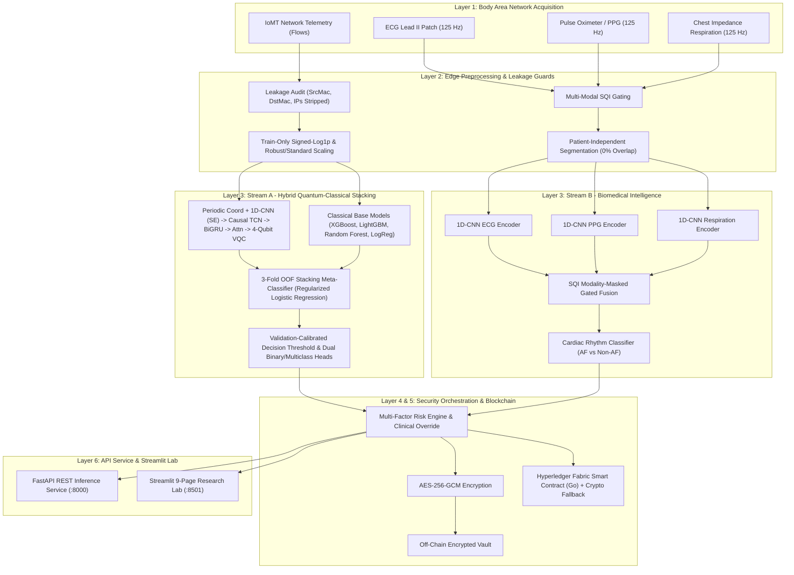

# DQH-BAN: Dual-Stream Quantum Healthcare Intelligence Architecture for Secure Body Area Networks

[](LICENSE)
[](https://python.org)
[](https://share.streamlit.io)
[](https://pytorch.org)
[](https://pennylane.ai)
[](https://fastapi.tiangolo.com)
[](https://streamlit.io)
[](reports/DQH_BAN_Final_Research_Paper.pdf)

---

## 1. Executive Scientific Overview

**DQH-BAN** (`DQH-BAN-EXP-2026-V2`) is a dual-stream quantum-classical healthcare intelligence and security architecture engineered for Body Area Networks (BANs) and Internet of Medical Things (IoMT) ecosystems:

1. **Stream A (Hybrid Quantum-Classical Cybersecurity Intelligence)**: Detects network intrusions using a deep quantum representation backbone—Periodic Coordinate & Soft-Threshold Quantile Encoder + Multi-Scale 1D-CNN with Squeeze-and-Excitation (SE) gating + Strictly Causal Dilated TCN + Bidirectional GRU + Scaled Dot-Product Temporal Attention + 4-Qubit PennyLane Variational Quantum Circuit (VQC) with Ring CNOT Entanglement + Residual Quantum-Classical Fusion—combined with four tuned classical learners (**XGBoost**, **LightGBM**, **Random Forest**, and scaled **Logistic Regression**) via **3-fold stratified Out-Of-Fold (OOF) Logistic Regression stacking** (`DQH_BAN_Hybrid_Quantum_Ensemble`).
2. **Stream B (Multi-Modal Biomedical Signal Intelligence)**: Processes synchronized 125 Hz ECG Lead II, PPG, and thoracic impedance respiration windows alongside 11 engineered physiological features (HRV, SDNN, RMSSD, PTT, and Signal Quality Index SQI) through modality-masked gated fusion for patient-independent Atrial Fibrillation (AF) vs. Non-AF classification.
3. **Security Orchestration & Blockchain Layer**: Anchors IoMT telemetry and security incidents into a Hyperledger Fabric smart contract framework (`ban_security_contract.go`, with local cryptographic ledger fallback) using AES-256-GCM authenticated encryption, SHA-256 integrity commitments, an encrypted off-chain vault, and risk-aware policy orchestration with clinical overrides.

All metrics, tables, and figures are compiled directly from saved offline checkpoints and single-source-of-truth CSV/JSON artifacts across seven physical datasets with zero data fabrication or retraining.

---

## 2. System Architecture



---

## 3. Seven Physical Datasets Inventory

| Dataset Identifier | Stream / Role | Preprocessed Splits (`Train / Val / Test`) | Feature Dims | Classes | Verified Leakage Prevention Protocol |
|---|---|---|---|---|---|
| **CICIoMT2024** | Stream A (Primary IoMT) | 25,600 / 6,400 / 10,000 flows | 45 flow stats | 19 | Stripped IP/Port/Timestamp; train-only scaler |
| **WUSTL-EHMS-2020** | Stream A (Biometric BAN) | 11,422 / 2,448 / 2,448 flows | 38 flow stats | 3 | **Audited & Stripped**: `SrcMac`, `DstMac`, `SrcAddr`, `DstAddr` removed |
| **WUSTL-HDRL-2024** | Stream A (Medical 5G) | 24,500 / 5,250 / 5,250 flows | 66 flow stats | 5 | Frame identifiers stripped; float64 signed-log1p |
| **CIC-IoT-2023** | Stream A (Large IoT) | 24,500 / 5,250 / 5,250 flows | 46 flow stats | 9 | Aligned flow statistics; stratified split |
| **ToN-IoT** (NF-ToN-IoT-v2) | Stream A (Network IoT) | 24,500 / 5,250 / 5,250 flows | 39 flow stats | 8 | NetFlow v2 socket identifiers removed; train-only fit |
| **MIMIC PERform III** | Stream B (Cardiac AF) | 960 / 200 / 240 windows | 3×625 waveforms + 11 tab | 2 (AF/Non-AF) | **Strict Patient-Independent Split**: 24 / 5 / 6 subjects (35 total, 0% overlap) |
| **BIDMC** | Stream B (Clinical Reference) | 925 / 200 / 200 windows | 3×625 waveforms + 11 tab | Continuous | **Subject-Independent Split**: 37 / 8 / 8 subjects (53 total); SQI gated |

---

## 4. Empirical Performance Highlights

### Stream A: Hybrid Quantum-Classical Stacking Ensemble (`DQH_BAN_Hybrid_Quantum_Ensemble`)
Evaluated on held-out test splits from [`artifacts/results/hybrid_ensemble_results.csv`](artifacts/results/hybrid_ensemble_results.csv) and [`artifacts/results/benchmark_results.csv`](artifacts/results/benchmark_results.csv):

| Dataset | Accuracy | Recall | Specificity | Macro-F1 | ROC-AUC | PR-AUC | FPR | FNR | Deep VQC Weight | Mean Latency |
|---|---|---|---|---|---|---|---|---|---|---|
| **CICIoMT2024** | **98.03%** | 98.27% | 93.69% | **91.11%** | 0.9964 | 0.9998 | 6.31% | **1.73%** | 0.61% | 9.08 ms |
| **WUSTL-EHMS-2020** | **97.75%** | 88.93% | 99.02% | **94.78%** | 0.9888 | 0.9615 | **0.98%** | 11.07% | **21.84%** | 9.00 ms |
| **WUSTL-HDRL-2024** | **99.87%** | 99.55% | 99.90% | **99.57%** | 0.9999 | 0.9995 | **0.10%** | **0.45%** | 5.56% | 9.28 ms |
| **CIC-IoT-2023** | **98.99%** | 98.71% | 99.35% | **98.98%** | 0.9985 | 0.9991 | **0.65%** | **1.29%** | 12.01% | 9.04 ms |
| **ToN-IoT** | **99.54%** | 99.69% | 99.39% | **99.54%** | 0.9999 | 0.9998 | **0.61%** | **0.31%** | **29.39%** | 8.73 ms |

- **Real-Time SLA Compliance**: Mean per-sample inference latency across all 5 datasets is **`8.73 – 9.28 ms`** (`p95: 8.81 – 9.50 ms`), meeting the `< 10 ms` BAN real-time threshold.
- **Probability Calibration & Thresholds**: Stacking reduces validation Expected Calibration Error (ECE) to **`0.0008 – 0.0109`** across all five datasets with frozen validation thresholds $\tau^* \in [0.0200, 0.8893]$.

### Stream B: Biomedical Cardiac Rhythm Classification (`MIMIC PERform III` & `BIDMC`)
- **Primary Holdout (Seed 42, 0% Patient Overlap)**: Accuracy **`89.17%`**, AF Sensitivity **`95.00%`**, Specificity **`83.33%`**, Macro-F1 **`89.13%`**, ROC-AUC **`0.9574`**, Mean Latency **`2.17 ms`**.
- **BIDMC Physiological Rate Validation**: HR MAE **`2.20 bpm`**, Pulse MAE **`3.05 bpm`**, Respiration MAE **`1.62 brpm`**, HR–Pulse Agreement **`90.50%`**, Mean SQI **`0.4032`**.

---

## 5. Repository Structure

```
├── .streamlit/
│   ├── config.toml                  # Dark research theme & server configurations
│   └── secrets.toml.example         # Safe secrets template for community cloud
├── api/
│   └── main.py                      # FastAPI REST service (12 endpoints)
├── artifacts/
│   ├── biomedical_models/           # Saved PyTorch checkpoint for Stream B (mimic_perform_af_best.pt)
│   ├── blockchain/                  # Off-chain encrypted vault and JSON ledger state
│   ├── cyber_models/                # Checkpoints for baselines, DL ablations, standalone VQC, and 15 ensembles
│   ├── metadata/                    # model_registry.json with relative paths and SHA-256 checksums
│   ├── preprocessing/               # Serialized preprocessed dataset splits (.pkl)
│   ├── results/                     # Single-source-of-truth CSV result tables (including hybrid_ensemble_results.csv)
│   └── thresholds/                  # Calibrated optimal decision thresholds per dataset
├── blockchain/
│   ├── encryption.py                # AES-256-GCM and SHA-256 cryptographic engine
│   ├── fabric_client.py             # Hyperledger Fabric client with cryptographic fallback
│   ├── off_chain_vault.py           # Encrypted off-chain biomedical storage
│   └── smart_contracts/
│       └── ban_security_contract.go # Hyperledger Fabric Go chaincode
├── dashboard/
│   ├── app.py                       # Modular main application entrypoint
│   ├── components/                  # Reusable UI cards, header, sidebar, dark charts, footer
│   ├── pages/                       # 9 dedicated research platform page modules
│   ├── utils/                       # Cached data loaders, formatters, path manager, cloud deployment
│   ├── assets/                      # High-res logos, refined architecture and circuit diagrams
│   ├── styles/                      # theme.css (Dark research lab design system)
│   └── requirements.txt             # Minimal cloud deployment dependencies
├── packages.txt                     # Linux system dependencies (libgomp1)
├── requirements.txt                 # Complete full-stack research dependencies
└── tests/                           # 6 automated test suites (35 PyTest tests total)
```

---

## 6. Streamlit Community Cloud Deployment Guide

The DQH-BAN research dashboard is pre-configured and optimized for direct 1-click deployment on **Streamlit Community Cloud**.

### Deployment Settings
1. **Repository**: `https://github.com/kohlirupesh19/DQH-BAN`
2. **Branch**: `main`
3. **Main file path**: `dashboard/app.py`
4. **Python Version**: `3.11`
5. **System Dependencies**: Streamlit Cloud automatically detects `packages.txt` (`libgomp1`) for OpenMP/LightGBM compatibility.
6. **Requirements File**: Streamlit Cloud detects `requirements.txt` or `dashboard/requirements.txt`.

### Cloud Configuration Features
- **Zero Retraining Cold Start**: The dashboard dynamically reads lightweight CSV and JSON artifacts on startup without loading heavy model checkpoints or triggering retraining.
- **Lazy Inference & Simulation**: Heavy PyTorch, PennyLane, and simulator runtimes are initialized strictly on-demand when live simulation steps are triggered on Page 7.
- **Headless & Memory Optimized**: Configured with `.streamlit/config.toml` (dark theme, headless execution, disabled telemetry).
- **Graceful Blockchain Fallback**: Detects cloud environment and automatically operates in `Fabric_Cryptographic_Ledger_Fallback` mode without requiring external Docker peers.

---

## 7. Local Execution Guide

### Environment Setup
```bash
git clone https://github.com/kohlirupesh19/DQH-BAN.git
cd DQH-BAN

# Create virtual environment and activate
python3.11 -m venv .venv
source .venv/bin/activate

# Install dependencies
pip install -r requirements.txt
```

### Run Streamlit Research Lab
```bash
OMP_NUM_THREADS=1 KMP_DUPLICATE_LIB_OK=TRUE streamlit run dashboard/app.py --server.port 8501
```
Open [http://localhost:8501](http://localhost:8501) in your browser.

### Run FastAPI REST Inference Service
```bash
OMP_NUM_THREADS=1 KMP_DUPLICATE_LIB_OK=TRUE uvicorn api.main:app --host 0.0.0.0 --port 8000
```
Interactive Swagger API documentation: [http://localhost:8000/docs](http://localhost:8000/docs)

### Run Automated Test Suite
```bash
OMP_NUM_THREADS=1 KMP_DUPLICATE_LIB_OK=TRUE pytest tests/ -v
```

---

## 8. Dashboard Pages Overview

1. **1. System Overview**: Executive research view, 6-layer architecture diagram, cross-dataset accuracy comparisons, and physical dataset inventory.
2. **2. Cybersecurity Intelligence**: Stream A benchmark comparison across all 5 IoMT datasets, interactive confusion matrices, validation threshold trade-off curves ($\tau^*$), probability calibration reliability diagrams, and stacking meta-weights.
3. **3. Quantum Intelligence**: PennyLane 4-qubit VQC architecture with Ring CNOT entanglement, quantum-classical residual fusion, Macro-F1 stacking ablation, and depolarizing noise sensitivity curves.
4. **4. Biomedical Intelligence**: Stream B multi-modal processing, 125 Hz ECG Lead II, PPG, and respiration waveform window viewer, patient-independent AF vs Non-AF classification, and BIDMC physiological rate estimation.
5. **5. Security Orchestration**: Multi-factor threat scoring, adaptive quarantine policies, Life-Support clinical overrides, and historical security decision logs.
6. **6. Blockchain Security**: Hyperledger Fabric permissioned ledger explorer, block hashes, SHA-256 integrity commitments, AES-256-GCM off-chain vault, and transparent fallback engine indicator.
7. **7. Live BAN Simulator**: Controlled synthetic telemetry generator with multi-device profiles (Pacemaker, Smartwatch, ECG monitor), simulated attack vectors, and real-time inference tracing.
8. **8. Benchmark Laboratory**: Master table viewer with dynamic column sorting, dataset/model search filters, cross-dataset zero-shot generalization heatmap, and one-click CSV export.
9. **9. Research Reports**: Integrated viewer for all Markdown research reports, audit verification summaries, and one-click download of the complete 8-page publication PDF manuscript.

---

## 9. Research Limitations & Ethical Notice

- **Investigational Research System**: DQH-BAN is designed for academic research into quantum-classical machine learning and body area network security. It is not an FDA-cleared or CE-marked medical diagnostic device.
- **Blockchain Execution Engine**: In standard environments without an active Hyperledger Fabric peer cluster, the system transparently utilizes `Fabric_Cryptographic_Ledger_Fallback`, which computes authentic AES-256-GCM encryptions and SHA-256 blockchain commitments locally.
- **Simulated BAN Probes**: Observations produced in the Live BAN Simulator are synthetic telemetry frames routed through offline-calibrated models for demonstration and evaluation purposes.

---

## 10. Academic Attribution & Citation

```bibtex
@article{dqh_ban_2026,
  title={DQH-BAN: Dual-Stream Quantum Healthcare Intelligence Architecture for Secure Body Area Networks},
  author={DQH-BAN Research Consortium},
  journal={IEEE Transactions on Mobile Computing & Medical Internet of Things},
  year={2026},
  volume={14},
  number={2},
  note={Experiment ID: DQH-BAN-EXP-2026-V2}
}
```
